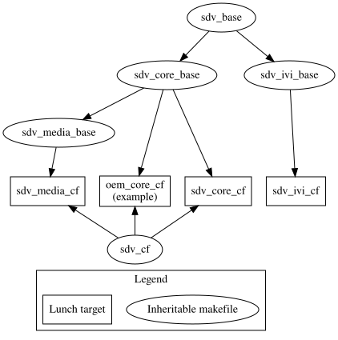

<!-- Copyright 2024 Google LLC -->

# SDV lunch targets

This directory contains Makefiles used to define SDV lunch targets.

## Hierarchy

## Inheritable lunch targets

OEM-defined targets are intended to derive from those base targets as needed.
OEM targets are intended to directly inherit from one SDV "base" target, and a
"vendor" target.

### SDV "base" targets

* `sdv_base` is the base for lunch targets that need to communicate with the SDV
  system using SDV communications stack.

* `sdv_core_base` is the base for lunch targets that need the full set of SDV
  Core services.

* `sdv_media_base` is the base for lunch targets that, aside from SDV Core
  services, also require media API support.

* `sdv_ivi_base` is the base for AAOS IVI lunch targets capable of communicating
  with SDV services on other VMs.

### Vendor targets

* `sdv_cf` contains Cuttlefish-specific functionality specific to SDV
  Core-derived targets. Note that it's *not* used by `sdv_ivi_cf`.

## Sample targets

`sdv_core_cf`, `sdv_media_cf` and `sdv_ivi_cf` are examples of the complete SDV
targets deriver from the ones above.
